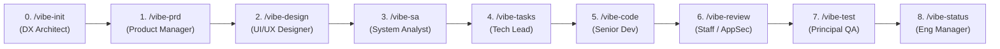

# ⚡ Vibe Coding Pipeline — Multi-Agent SDLC Framework (Edisi 2026)

[](https://www.npmjs.com/package/@neko-koubou/vibe-coding-pipeline)
[](https://github.com/Neko-Koubou/vibe-coding-pipeline/releases/latest)
[](./LICENSE)
[](#-10-tabel-direktori-agent)
[](#-10-tabel-direktori-agent)

> **Install sekali. Jalankan satu tim engineering AI yang lengkap (product, desain, arsitektur, coding, review, dan QA) di semua project, di Windows, macOS, dan Linux.**
>
> Tersedia sebagai **slash command (`/vibe-*`)** dan **Agent Skills (`SKILL.md` / `$vibe-*`)** untuk **Claude Code, Google Antigravity (IDE & CLI), OpenCode, OpenAI Codex + ChatGPT App, Cursor, Windsurf, dan Roo Code / Cline**.

🇬🇧 **[Read in English (README.md)](./README.md)**: isi panduannya sama, dalam bahasa Inggris.

```bash
npx Neko-Koubou/vibe-coding-pipeline
```

---

## 📖 Daftar Isi
1. [Kenapa Vibe Coding Pipeline?](#-1-kenapa-vibe-coding-pipeline)
2. [Cara Kerjanya](#-2-cara-kerjanya)
3. [Kebutuhan](#-3-kebutuhan)
4. [Instalasi](#-4-instalasi)
   - [4.1 Opsi A: npx (disarankan)](#41-opsi-a-npx-disarankan)
   - [4.2 Opsi B: CLI permanen dengan `npm i -g`](#42-opsi-b-cli-permanen-dengan-npm-i--g)
   - [4.3 Opsi C: dari hasil clone repository ini](#43-opsi-c-dari-hasil-clone-repository-ini)
   - [4.4 Scope Global vs Project](#44-scope-global-vs-project)
   - [4.5 Panduan installer interaktif](#45-panduan-installer-interaktif)
   - [4.6 Opsi installer](#46-opsi-installer)
   - [4.7 Apa saja yang di-install](#47-apa-saja-yang-di-install)
   - [4.8 Cek hasil instalasi](#48-cek-hasil-instalasi)
   - [4.9 Update ke versi terbaru](#49-update-ke-versi-terbaru)
   - [4.10 Uninstall](#410-uninstall)
5. [Panduan Pemakaian](#-5-panduan-pemakaian)
   - [5.1 Aturan emas](#51-aturan-emas)
   - [5.2 Skenario A: dari ide mentah](#52-skenario-a-dari-ide-mentah)
   - [5.3 Skenario B: sudah punya `prd.md`](#53-skenario-b-sudah-punya-prdmd)
   - [5.4 Skenario C: menambah fitur di codebase yang sudah ada](#54-skenario-c-menambah-fitur-di-codebase-yang-sudah-ada)
6. [Referensi Tiap Tahap](#-6-referensi-tiap-tahap)
7. [Penanda Status](#-7-penanda-status)
8. [Context Compaction & Melanjutkan Pekerjaan](#-8-context-compaction--melanjutkan-pekerjaan)
9. [Contekan Command](#-9-contekan-command)
10. [Tabel Direktori Agent](#-10-tabel-direktori-agent)
11. [Troubleshooting & FAQ](#-11-troubleshooting--faq)
12. [Struktur Repository & Rilis](#-12-struktur-repository--rilis)
13. [Lisensi](#-13-lisensi)

---

## 🎯 1. Kenapa Vibe Coding Pipeline?

Prompting asal-asalan gagal di project sungguhan karena **context rot**: setelah 20+ pesan, model mulai lupa constraint database, mengarang route API yang tidak konsisten, dan melewatkan state UI untuk edge case. Sesi yang panjang juga otomatis **di-compact** (diringkas), dan detail-detail ikut hilang bersama ringkasannya.

Vibe Coding Pipeline mengatasinya dengan **serah-terima berbasis artifact**:
- **9 persona spesialis**: setiap command berperan sebagai satu role senior (DX Architect, Product Manager, UI/UX Designer, System Analyst, Tech Lead, Full-Stack Developer, Staff AppSec Reviewer, QA Engineer, Engineering Manager).
- **Memori berbasis file (`docs/vibe/`)**: setiap tahap membaca blueprint Markdown dari tahap sebelumnya di disk, lalu menulis satu artifact terstruktur untuk tahap berikutnya. Keputusan tersimpan di file, bukan di riwayat chat.
- **Context baru di tiap tahap**: karena semuanya ada di disk, kamu cukup membersihkan chat di antara tahap. Setiap agent mulai dengan fokus penuh dan token yang lebih hemat.
- **Coding atomik yang terverifikasi**: `/vibe-code` mengerjakan tepat satu task kecil, menjalankan Definition of Done-nya, dan mencatat hasilnya sebelum kamu lanjut.
- **Aman dari compaction**: progres disimpan sebagai checkpoint di disk, jadi tahap yang terputus atau ter-compact akan lanjut dari titik terakhir, bukan melompati pekerjaan.

---

## 🔄 2. Cara Kerjanya



| Tahap | Command / Skill | Persona | Membaca dari | Menulis (`docs/vibe/`) |
| :--- | :--- | :--- | :--- | :--- |
| **0. Init** | `/vibe-init` | Principal DX Architect | Manifest, folder & config repo | `00-project-context.md` |
| **1. Product** | `/vibe-prd` | Senior Product Manager | Ide kamu atau `prd.md` yang sudah ada | `01-prd.md` |
| **2. Design** | `/vibe-design` | Principal UI/UX Designer | `00` + `01` + kode UI yang sudah ada | `02-design-spec.md` |
| **3. Architecture** | `/vibe-sa` | Principal System Analyst | `00` + `01` + `02` + model/route yang sudah ada | `03-system-analysis.md` |
| **4. Planning** | `/vibe-tasks` | Technical Lead | `00` sampai `03` | `04-tasks.md` |
| **5. Coding** | `/vibe-code` | Senior Full-Stack Developer | `04` + `00` + `02` + `03` + `05` | Kode production + `05-implementation-log.md` |
| **6. Review** | `/vibe-review` | Staff Engineer & AppSec Auditor | `00` sampai `05` + commit tiap task | `06-code-review.md` |
| **7. Testing** | `/vibe-test` | Principal QA Engineer | `00` sampai `03` + kodenya | Automated test + `07-qa-report.md` |
| **8. Status** | `/vibe-status` | Engineering Manager | Semua isi `docs/vibe/` | Dashboard progres di chat |

Semua artifact ada di **`docs/vibe/`**, di root project yang sedang kamu kerjakan:

```text
docs/vibe/
├── 00-project-context.md     # /vibe-init    tech stack, konvensi, command verifikasi
├── 01-prd.md                 # /vibe-prd     user story (US-01...) dengan kriteria Gherkin
├── 02-design-spec.md         # /vibe-design  design token, wireframe, matriks 5 state UI
├── 03-system-analysis.md     # /vibe-sa      arsitektur, ERD, kontrak API, sequence
├── 04-tasks.md               # /vibe-tasks   daftar TASK-001... berurutan dengan penanda status
├── 05-implementation-log.md  # /vibe-code    satu entri checkpoint per task
├── 06-code-review.md         # /vibe-review  verdict + temuan
└── 07-qa-report.md           # /vibe-test    ringkasan test + matriks traceability
```

---

## ✅ 3. Kebutuhan

| Yang kamu perlukan | Untuk |
| :--- | :--- |
| Minimal satu AI coding agent yang didukung | Claude Code, Google Antigravity, OpenCode, Codex CLI / ChatGPT app, Cursor, Windsurf, atau Roo Code / Cline |
| **Node.js 18+** (sudah termasuk `npm` / `npx`) | Installer npx / npm (Opsi A dan B) |
| **git** | `npx Neko-Koubou/vibe-coding-pipeline` (mengunduh dari GitHub), dan disarankan ada di project kamu karena `/vibe-code` dan `/vibe-review` bekerja dengan commit per task |
| **bash** (macOS, Linux, WSL, Git Bash) atau **Python 3** | Hanya untuk installer dari hasil clone (Opsi C) |

---

## 🚀 4. Instalasi

### 4.1 Opsi A: npx (disarankan)

Tidak perlu clone. Pilih salah satu sumber:

```bash
# Dari GitHub: selalu versi main terbaru (butuh git)
npx Neko-Koubou/vibe-coding-pipeline

# Dari npm: rilis terbaru yang sudah dipublish (tidak butuh git)
npx @neko-koubou/vibe-coding-pipeline@latest
```

Tanpa opsi, installer akan mengajukan dua pertanyaan (scope dan agent, lihat [4.5](#45-panduan-installer-interaktif)). Pertanyaan itu bisa dilewati dengan opsi:

```bash
npx Neko-Koubou/vibe-coding-pipeline --global --agents claude,antigravity,codex
npx Neko-Koubou/vibe-coding-pipeline --project ./my-app --agents all
npx Neko-Koubou/vibe-coding-pipeline --yes     # Global + Claude Code, Antigravity, Codex
```

### 4.2 Opsi B: CLI permanen dengan `npm i -g`

```bash
npm i -g @neko-koubou/vibe-coding-pipeline      # dari npm
# atau
npm i -g Neko-Koubou/vibe-coding-pipeline       # dari GitHub
```

Ini menambahkan dua command yang identik, `vibe-pipeline` dan `vibe-coding-pipeline`. Opsinya sama dengan npx:

```bash
vibe-pipeline --help
vibe-pipeline --global --agents claude,codex
vibe-pipeline uninstall
```

> **Jangan lupa `-g`.** `npm i ...` biasa di dalam sebuah project hanya menambahkan paket ke `package.json` project itu. Perintah itu **tidak** meng-install command `/vibe-*` apa pun. Kotak **Install** di halaman npm selalu menampilkan `npm i <paket>`; npm membuatnya otomatis.

### 4.3 Opsi C: dari hasil clone repository ini

```bash
git clone https://github.com/Neko-Koubou/vibe-coding-pipeline.git
cd vibe-coding-pipeline

./install.sh            # macOS / Linux / WSL / Git Bash
python3 install.py      # OS apa pun yang punya Python 3
.\install.ps1           # Windows PowerShell (menjalankan install.py, jadi butuh Python 3)
```

Ketiga script ini meng-install file yang persis sama dengan CLI npx. Kalau `./install.sh` menampilkan "Permission denied", jalankan `chmod +x install.sh` sekali.

### 4.4 Scope Global vs Project

| | 🌍 **Global** (disarankan) | 📁 **Project** |
| :--- | :--- | :--- |
| Di-install ke | Folder user kamu (`~/.claude`, `~/.codex`, `~/.gemini`, ...) | Satu repository (`.claude/`, `.codex/`, `.agents/`, `AGENTS.md`, ...) |
| Tersedia di | Semua project di komputer ini | Hanya project itu |
| Dibagikan ke tim | Tidak | Ya: commit folder-folder yang dibuat |
| Tambahan | — | Membuat `docs/vibe/` di project |

Folder persis untuk tiap agent ada di [Tabel Direktori Agent](#-10-tabel-direktori-agent).

### 4.5 Panduan installer interaktif

Installer mengajukan dua pertanyaan.

**Langkah 1/2: pilih scope**

```text
STEP 1/2 — Choose the installation scope:
  [1] 🌍 GLOBAL (Recommended) — install once on macOS (arm64), available in EVERY project
  [2] 📁 SINGLE PROJECT       — install into one project folder only

👉 Choose scope [1 = Global, 2 = Project] (default: 1):
```

Tekan **ENTER** untuk Global. Pilih **2** untuk Project; installer lalu menanyakan folder project-nya (ENTER = folder saat ini).

**Langkah 2/2: pilih agent**

```text
STEP 2/2 — Choose your AI agents (multi-select | scope: GLOBAL):
  [x] 1) Claude Code (CLI & IDE)        -> ~/.claude/commands
  [x] 2) Google Antigravity (IDE & CLI) -> ~/.gemini/config/global_workflows
  [ ] 3) OpenCode (CLI / Desktop)       -> ~/.config/opencode/command
  [x] 4) Codex CLI + ChatGPT App        -> ~/.codex/prompts
  [ ] 5) Cursor (AI IDE)                -> ~/.cursor/commands
  [ ] 6) Windsurf (Agentic IDE)         -> ~/.codeium/windsurf/global_workflows
  [ ] 7) Roo Code / Cline               -> ~/.roo/commands

  • Type numbers to toggle (e.g. 1,2,4) | 'a' = all | 'n' = none
  • Press ENTER when you are done to start installing
👉 Your choice:
```

| Ketik | Efek |
| :--- | :--- |
| Angka, misalnya `3` atau `1,5` atau `3 5` | Centang / hapus centang agent tersebut |
| `a` | Pilih semua agent |
| `n` | Kosongkan pilihan |
| **ENTER** | Install agent yang dicentang (minimal satu) |

Claude Code, Antigravity, dan Codex sudah dicentang secara default.

### 4.6 Opsi installer

| Opsi | npx / `vibe-pipeline` | `install.sh` | `install.py` | `install.ps1` |
| :--- | :--- | :--- | :--- | :--- |
| Scope global | `-g`, `--global` | `-g`, `--global` | `-g`, `--global` | `-Scope global` |
| Scope project | `-p [dir]`, `--project [dir]` | `-p [dir]`, `--project [dir]` | `-p`, `--project` (folder lewat `-t`) | `-Scope project` |
| Folder project | `-t <dir>`, `--target <dir>` | `-t <dir>`, `--target <dir>` | `-t <dir>`, `--target <dir>` | `-Target <dir>` |
| Agent | `-a <list>`, `--agents <list>` | `-a <list>`, `--agents <list>` | `-a <list>`, `--agents <list>` | `-Agents <list>` |
| Tanpa pertanyaan, pakai default | `-y`, `--yes` | — | — | — |
| Versi / bantuan | `-v`, `-h` | `-h` | `-h` | — |
| Uninstall (global) | `uninstall` | `./uninstall.sh` | `python3 uninstall.py` | `.\uninstall.ps1` |

Nama agent untuk `--agents` (dipisah koma atau spasi):

| # | Key | Juga diterima npx & `install.sh` | Agent |
| :--- | :--- | :--- | :--- |
| 1 | `claude` | `claude-code` | Claude Code |
| 2 | `antigravity` | `ag` | Google Antigravity (IDE & CLI) |
| 3 | `opencode` | — | OpenCode |
| 4 | `codex` | `chatgpt` | Codex CLI + ChatGPT App |
| 5 | `cursor` | — | Cursor |
| 6 | `windsurf` | — | Windsurf |
| 7 | `roocode` | `roo`, `cline` | Roo Code / Cline |
| — | `all` | — | Ketujuh agent |

`install.py` menerima key dan angka. Dengan `--yes`, CLI npx memakai scope Global serta Claude Code, Antigravity, dan Codex, kecuali kamu juga memberi `--global`/`--project` atau `--agents`.

### 4.7 Apa saja yang di-install

| Apa | Detail |
| :--- | :--- |
| **9 slash command / workflow / prompt** | `vibe-init.md` … `vibe-status.md`, disalin ke folder command tiap agent |
| **9 Agent Skills** | Folder `vibe-*/SKILL.md`, untuk agent yang mendukung skills (bukan Windsurf atau Roo Code) |
| **Blok rules** | Protokol pipeline yang selalu aktif, termasuk aturan compaction dan bagian **Compact Instructions**. Di file bersama (`CLAUDE.md`, `AGENTS.md`, `GEMINI.md`, `global_rules.md`) blok ini berada di antara `<!-- vibe-pipeline:start -->` dan `<!-- vibe-pipeline:end -->`; isi lain di file itu tidak pernah disentuh. File khusus (`vibe-pipeline.md`, `vibe-pipeline.mdc`) cukup ditimpa. |
| **`docs/vibe/`** | Dibuat kosong pada scope Project; tahap-tahap pipeline yang mengisinya |

### 4.8 Cek hasil instalasi

1. Restart agent kamu atau buka sesi baru supaya command baru termuat.
2. Ketik `/vibe-` (atau `$vibe-` di Codex): seharusnya muncul 9 tahap.
3. Atau cek file-nya langsung, misalnya:

```bash
ls ~/.claude/skills | grep vibe     # Claude Code, install global
ls ~/.codex/skills | grep vibe      # Codex, install global
```

### 4.9 Update ke versi terbaru

Jalankan installer lagi dengan scope dan agent yang sama:

```bash
npx Neko-Koubou/vibe-coding-pipeline              # selalu mengambil main terbaru
npx @neko-koubou/vibe-coding-pipeline@latest      # rilis npm terbaru
```

Dari hasil clone, jalankan `git pull` dulu, lalu jalankan ulang `install.sh` / `install.py`. Command dan skill akan ditimpa. Blok Vibe di file rules bersama diganti di tempat, dan isi milikmu di file-file itu tetap aman. Restart agent setelahnya.

### 4.10 Uninstall

```bash
npx Neko-Koubou/vibe-coding-pipeline uninstall    # OS apa pun yang punya Node.js
./uninstall.sh                                     # macOS / Linux / Git Bash
.\uninstall.ps1                                    # Windows PowerShell
python3 uninstall.py                               # OS apa pun yang punya Python 3
```

**Yang dihapus** (install global, ketujuh agent): semua command, workflow, prompt, dan skill `vibe-*`, file `vibe-pipeline.mdc` milik Cursor, dan file sisa installer Antigravity versi lama.

**Yang dibiarkan**, jadi bisa kamu hapus manual kalau mau:
- blok Vibe di dalam `~/.claude/CLAUDE.md`, `~/.codex/AGENTS.md`, `~/.gemini/GEMINI.md`, `~/.gemini/config/GEMINI.md`, `~/.config/opencode/AGENTS.md`, dan `~/.codeium/windsurf/memories/global_rules.md`: hapus semuanya dari `<!-- vibe-pipeline:start -->` sampai `<!-- vibe-pipeline:end -->` (instalasi lama tidak punya penanda ini; bloknya dimulai dari `# Vibe Coding Pipeline — Multi-Agent Engineering Protocol`);
- `~/.roo/rules/vibe-pipeline.md`;
- **Install Project**: hapus file `vibe-*` dari folder project yang ada di [tabel](#-10-tabel-direktori-agent);
- artifact `docs/vibe/` milikmu.

---

## 🧭 5. Panduan Pemakaian

### 5.1 Aturan emas

1. **Satu tahap per chat.** Bersihkan context di antara tahap (`/clear` di Claude Code, atau buka chat/sesi baru di agent kamu). Setiap tahap membaca yang dibutuhkan dari `docs/vibe/`.
2. **Review setiap artifact sebelum lanjut.** Kalau ada yang salah, edit file-nya; tahap berikutnya membaca file, bukan chat.
3. **Commit setelah setiap task `/vibe-code`**, dan tulis ID task di pesan commit (`feat: complete TASK-003`). `/vibe-review` menemukan pekerjaan lewat commit-commit itu.
4. **Terputus atau ter-compact? Jalankan command yang sama lagi.** Setiap tahap melanjutkan dari checkpoint di disk (lihat [bagian 8](#-8-context-compaction--melanjutkan-pekerjaan)).
5. **Bingung? Jalankan `/vibe-status`.** Command ini menampilkan progres dan command berikutnya yang perlu dijalankan.

### 5.2 Skenario A: dari ide mentah

1. **Siapkan context project**
   ```text
   /vibe-init Next.js 15 App Router, Tailwind CSS, Go ConnectRPC backend, PostgreSQL, Redis
   ```
   Menulis `00-project-context.md`: tech stack, konvensi folder, dan command build/lint/test yang persis. Di folder kosong tanpa stack, tahap ini mengusulkan stack atau mengajukan maksimal 3 pertanyaan.

2. **Tulis PRD** (bersihkan chat dulu)
   ```text
   /vibe-prd Buat platform kuis multiplayer real-time dengan lobby host, join lewat QR, leaderboard live, dan sinkronisasi state lewat Redis
   ```
   Jawab 3–5 pertanyaan klarifikasi kalau ditanya (atau tambahkan `--auto` supaya memakai default yang masuk akal). Menulis `01-prd.md` berisi user story bernomor `US-01`, `US-02`… dengan kriteria penerimaan Gherkin.

3. **Desain UI** (bersihkan chat)
   ```text
   /vibe-design Tema gelap yang modern dan playful, layar peserta mobile-first, tampilan proyektor desktop untuk host
   ```
   Menulis `02-design-spec.md`: design token, wireframe ASCII untuk setiap layar, props komponen, dan matriks 5 state UI. Lewati tahap ini untuk pekerjaan yang hanya backend.

4. **Desain sistem** (bersihkan chat)
   ```text
   /vibe-sa
   ```
   Menulis `03-system-analysis.md`: diagram arsitektur, ERD dan tabel database, setiap kontrak API beserta matriks error-nya, dan sequence diagram.

5. **Rencanakan task** (bersihkan chat)
   ```text
   /vibe-tasks
   ```
   Menulis `04-tasks.md`: task atomik `TASK-001`, `TASK-002`… dalam 6 phase, masing-masing menyentuh 1–4 file dan punya Definition of Done.

6. **Bangun, satu task per chat** (bersihkan chat sebelum setiap task)
   ```text
   /vibe-code
   ```
   Memilih task berikutnya yang siap dikerjakan (atau `/vibe-code TASK-003`, atau `/vibe-code phase 2`), mengimplementasikannya, menjalankan verifikasinya, menandainya `[x]`, dan mencatatnya di `05-implementation-log.md`. Lalu commit, bersihkan chat, dan jalankan `/vibe-code` lagi.

7. **Review phase yang sudah selesai** (bersihkan chat)
   ```text
   /vibe-review
   /vibe-review --fix
   ```
   Menulis `06-code-review.md` berisi verdict dan temuan. `--fix` memperbaiki temuan `[CRITICAL]` dan `[MAJOR]` satu per satu.

8. **Test** (bersihkan chat)
   ```text
   /vibe-test
   ```
   Menulis dan menjalankan unit, integration, dan E2E test, lalu `07-qa-report.md` berisi matriks traceability `US-xx → test → PASS/FAIL`.

9. **Cek progres kapan saja**
   ```text
   /vibe-status
   ```

### 5.3 Skenario B: sudah punya `prd.md`

Kalau kamu sudah menulis `prd.md` sendiri (atau mengekspornya dari Notion, Google Docs, atau ChatGPT), ada dua cara memakainya.

**Cara 1: biarkan `/vibe-prd` meng-import dan merapikannya (disarankan).** PRD yang ditulis manual biasanya belum punya ID `US-xx`, kriteria Given/When/Then, dan edge case yang dibutuhkan `/vibe-sa`, `/vibe-tasks`, dan `/vibe-test`.

1. Taruh `prd.md` di folder project kamu.
2. Jalankan `/vibe-init`.
3. Bersihkan chat, lalu jalankan:
   ```text
   /vibe-prd prd.md
   ```
   Di agent yang mendukung mention file, kamu bisa menulis `/vibe-prd @prd.md`. Menjalankan `/vibe-prd` tanpa argumen juga akan meng-import `prd.md` / `PRD.md` dari root project.
4. Product Manager mempertahankan 100% fitur dan constraint kamu, lalu melengkapi yang kurang: ID `US-*`, kriteria Gherkin, alur user dalam Mermaid, dan edge case. Hasilnya `docs/vibe/01-prd.md`.
5. Lanjutkan dengan `/vibe-design` → `/vibe-sa` → `/vibe-tasks` → `/vibe-code`.

**Cara 2: lewati `/vibe-prd` (jalur cepat)**, kalau PRD kamu sudah sangat detail:

1. Salin ke tempatnya:
   ```bash
   mkdir -p docs/vibe
   cp prd.md docs/vibe/01-prd.md
   ```
2. Jalankan `/vibe-init`.
3. Langsung ke `/vibe-design` (atau `/vibe-sa` untuk pekerjaan yang hanya backend).

Kalaupun kamu lupa langkah 1, `/vibe-design` dan `/vibe-sa` akan memakai `prd.md` / `PRD.md` di root project saat `01-prd.md` belum ada.

### 5.4 Skenario C: menambah fitur di codebase yang sudah ada

1. Buka repository-nya dan jalankan `/vibe-init`. Tahap ini membaca manifest (`package.json`, `go.mod`, `composer.json`, …), struktur folder, linter, dan setup database kamu.
2. Jalankan `/vibe-prd <deskripsi fitur baru>` (atau `/vibe-prd feature-prd.md`). Kalau `01-prd.md` sudah ada, file itu direvisi di tempat: ID `US-*` yang lama tetap, story baru mendapat ID baru.
3. Jalankan `/vibe-design` (kalau ada UI) dan `/vibe-sa`. System Analyst membaca model, migration, dan route yang sudah ada, sehingga schema dan endpoint baru menyatu tanpa merusak kode lama.
4. Jalankan `/vibe-tasks`. Kalau `04-tasks.md` sudah ada, task yang selesai atau sedang dikerjakan tetap dengan ID dan statusnya, dan task baru ditambahkan.
5. Lanjutkan dengan `/vibe-code` → `/vibe-review` → `/vibe-test`.

---

## 📚 6. Referensi Tiap Tahap

### 6.1 `/vibe-init`: Principal DX Architect
- **Argumen (opsional):** stack atau catatan project, misalnya `/vibe-init Laravel 12, Nuxt 3, PostgreSQL`.
- **Yang dikerjakan:** membuat `docs/vibe/`, mendeteksi Greenfield (baru) atau Brownfield (sudah ada kode), memindai manifest, struktur folder, linter, dan file env/docker, serta mencatat `prd.md` yang sudah ada. Untuk project Greenfield tanpa stack, tahap ini mengusulkan stack atau mengajukan maksimal 3 pertanyaan.
- **Menulis `00-project-context.md`:** identitas project dan gaya arsitektur; matriks tech stack (bahasa, frontend, backend & protokol API, database/ORM/cache/broker, framework test & linter); konvensi penamaan dan batas modul; command install/build/typecheck/lint/test yang persis; aturan wajib global (tanpa `any`, tanpa SQL tanpa parameter, tanpa secret yang di-hardcode).
- **Tidak pernah:** menulis kode fitur.
- **Berikutnya:** `/vibe-prd`.

### 6.2 `/vibe-prd`: Senior Product Manager
- **Argumen:** ide mentah, **atau** path file (`prd.md`, `@prd.md`, `docs/prd.md`, `requirements.md`). Kosong + ada `prd.md` di root = mode import. Tambahkan `--auto` untuk melewati pertanyaan.
- **Yang dikerjakan:** mengajukan 3–5 pertanyaan klarifikasi yang paling berpengaruh (dengan rekomendasi default) kalau role, scope, atau aturan bisnis belum jelas.
- **Menulis `01-prd.md`:** ringkasan eksekutif & masalah; persona & hak akses role; scope MoSCoW (P0 MVP / P1 / P2 / di luar scope); user story bernomor `US-01…` dengan Given/When/Then untuk jalur sukses dan negatif; alur user Mermaid `flowchart TD`; aturan bisnis, validasi & edge case; kebutuhan non-fungsional (latensi, keamanan, aksesibilitas, audit logging).
- **Dijalankan ulang:** merevisi di tempat dan mempertahankan ID `US-*`.
- **Tidak pernah:** menulis kode implementasi (fokusnya APA dan KENAPA).
- **Berikutnya:** `/vibe-design` untuk pekerjaan UI, `/vibe-sa` untuk pekerjaan yang hanya backend.

### 6.3 `/vibe-design`: Principal UI/UX Designer
- **Argumen (opsional):** arah gaya atau UI library, misalnya `/vibe-design Dashboard minimalis yang bersih memakai shadcn/ui`.
- **Yang dikerjakan:** membaca `01-prd.md` (atau `prd.md` di root sebagai cadangan), dan memeriksa stylesheet, config Tailwind, dan komponen yang sudah ada supaya tetap konsisten.
- **Menulis `02-design-spec.md`:** arah estetika & prinsip desain; design token (warna semantik untuk light dan dark mode, skala tipografi, spacing, grid, radius, elevation); wireframe ASCII untuk setiap layar dan modal di desktop dan mobile; hierarki komponen & kontrak props; **matriks 5 state** untuk setiap layar (Loading/Skeleton, Empty, Populated, Partial/Edge, Error/Offline); micro-interaction dan WCAG 2.1 AA (navigasi keyboard, focus trap, ARIA).
- **Tidak pernah:** menulis kode frontend production.
- **Berikutnya:** `/vibe-sa`.

### 6.4 `/vibe-sa`: Principal System Analyst
- **Argumen (opsional):** batasan arsitektur, misalnya `/vibe-sa Gunakan ConnectRPC, PostGIS, dan caching Redis`.
- **Yang dikerjakan:** membaca `00`, `01` (atau `prd.md` di root), dan `02`, lalu memeriksa model, migration, route, service, dan middleware kamu.
- **Menulis `03-system-analysis.md`:** diagram arsitektur Mermaid dan pemetaan file/modul yang persis; ERD Mermaid plus setiap tabel (kolom, tipe, nullability, default, foreign key dengan `ON DELETE`, index komposit/unik); kontrak untuk **setiap** endpoint (method, path/RPC, auth/RBAC, rate limit, header, query, body beserta aturan validasi, JSON sukses, matriks error `400/401/403/404/409/422/500`); sequence diagram untuk alur inti; transaksi, idempotency, locking, dan invalidasi cache; catatan OWASP Top 10 dan Architecture Decision Record.
- **Aturan:** tidak ada placeholder samar seperti "tambahkan field sesuai kebutuhan". Saat dijalankan ulang, judul-judul bagian tetap sama karena task menautkan ke sana.
- **Berikutnya:** `/vibe-tasks`.

### 6.5 `/vibe-tasks`: Technical Lead
- **Argumen (opsional):** petunjuk ukuran task atau phase.
- **Yang dikerjakan:** memastikan setiap user story, layar, tabel, dan endpoint tercakup oleh sebuah task.
- **Menulis `04-tasks.md`:** ringkasan eksekusi, dependency graph Mermaid, legenda status, dan task dalam 6 phase: (1) fondasi, config & tipe bersama; (2) migration, model & repository; (3) domain service & endpoint API; (4) design token, UI dasar & state; (5) layar fitur, integrasi API & 5 state UI; (6) hardening & polish. Setiap task memakai template ini:
  ```markdown
  ### - [ ] TASK-001: <Concise Action Title>
  - **Traceability**: `US-01`, `03-system-analysis.md#section`
  - **Depends On**: `None` (or `TASK-00X`)
  - **Target Files**:
    - `CREATE` `path/to/new_file.ext`
    - `MODIFY` `path/to/existing_file.ext`
  - **Implementation Specs**:
    - Step-by-step technical instructions referencing exact schemas/contracts.
  - **Definition of Done (Verification)**:
    - Exact command or assertion to verify before marking `[x]`.
  ```
- **Aturan:** setiap task menyentuh 1–4 file yang saling terkait erat, supaya muat dalam satu context window. Menjalankan ulang tetap mempertahankan ID task dan status `[x]` / `[~]` / `[!]`-nya.
- **Berikutnya:** `/vibe-code`.

### 6.6 `/vibe-code`: Senior Full-Stack Developer
- **Argumen (opsional):** kosong (task berikutnya), ID task (`TASK-003`), atau phase (`phase 2`).
- **Task mana:** task `[~]` yang belum selesai selalu dilanjutkan lebih dulu (kalau ada lebih dari satu, atau kamu menyebut task lain, agent akan bertanya). Selain itu: task yang kamu sebut, atau task pertama yang siap dikerjakan di phase itu, atau task `[ ]` pertama yang semua dependensinya sudah `[x]`. Kalau dependensinya belum selesai atau tidak ada yang siap, agent berhenti dan menjelaskan alasannya.
- **Checkpoint:** sebelum menulis kode, task ditandai `[~]` dan entri berikut ditambahkan ke `05-implementation-log.md`, lalu diperbarui setiap kali satu file selesai dan setiap percobaan verifikasi:
  ```markdown
  ## TASK-003: <title> — IN PROGRESS
  - **Started**: <timestamp>
  - **Plan**: <target files>
  - **Done so far**: none yet
  - **Verification**: pending
  ```
- **Aturan implementasi:** nama, tipe, route, status code, dan props persis seperti di `02`/`03`; typing ketat (nol `any`); error handling terstruktur; query berparameter; validasi input; kelima state UI; tanpa stub `TODO` atau debug log; tetap di dalam Target Files task tersebut.
- **Verifikasi:** menjalankan Definition of Done task itu plus command typecheck/lint dari `00`. Berhasil → `[x]` dan entri log `DONE` (file yang disentuh, command, hasil). Masih gagal setelah 3 kali perbaikan terarah, atau terhalang hal di luar task (secret yang belum ada, service, dependensi yang belum selesai) → `[!]` dan entri log `BLOCKED` dengan error persisnya. Agent tidak pernah menandai `[x]` saat pengecekan gagal.
- **Satu task per run:** berhenti setelah satu task. Commit, bersihkan chat, lalu jalankan `/vibe-code` lagi.

### 6.7 `/vibe-review`: Staff Engineer & AppSec Auditor
- **Argumen (opsional):** file atau ID task untuk mempersempit review, dan/atau `--fix`.
- **Cakupan:** karena setiap task sudah di-commit, review tidak hanya mengandalkan `git diff`. Yang di-review adalah setiap task `[x]` yang belum tercantum di **Reviewed Tasks**: file dari `05-implementation-log.md`, commit yang ditemukan lewat `git log --grep "TASK-"`, plus perubahan yang belum di-commit.
- **Mengaudit 4 pilar:** kesesuaian dengan blueprint (schema, status code, kolom/index, 5 state UI); keamanan (OWASP Top 10: access control/IDOR, injection, XSS, kebocoran secret, validasi atau rate limit yang hilang); performa & concurrency (N+1, transaksi yang hilang, race condition, kebocoran memori); kualitas kode (tipe, error, modularitas).
- **Menulis `06-code-review.md`:** verdict (`APPROVED`, `APPROVED WITH MINOR NOTES`, atau `CHANGES REQUESTED`), daftar kumulatif **Reviewed Tasks**, dan temuan bertanda `[CRITICAL]`, `[MAJOR]`, atau `[MINOR]`, masing-masing `[OPEN]` dengan `File:Line` dan perbaikan konkret.
- **`--fix`:** kalau `06-code-review.md` sudah berisi temuan `[CRITICAL]`/`[MAJOR]` yang masih terbuka, audit ulang dilewati dan temuan itu diperbaiki satu per satu, masing-masing langsung diubah menjadi `[RESOLVED]`. Setelah itu command verifikasi dijalankan dan verdict diperbarui. Temuan `[MINOR]` diserahkan ke kamu.
- **Berikutnya:** `/vibe-review --fix` kalau perlu, lalu `/vibe-test`.

### 6.8 `/vibe-test`: Principal QA Engineer
- **Argumen (opsional):** sebuah modul, user story (`US-01`), atau jenis test.
- **Yang dikerjakan:** pertama menulis `07-qa-report.md` sebagai `DRAFT` dengan satu baris traceability per user story dalam scope, semuanya `PENDING`. Lalu menulis dan menjalankan unit test (logika domain, batas nilai, input negatif), integration/API test (`200/201`, `400/422`, `401/403`, `404/409`), dan component/E2E test (alur user dan state UI), sambil memperbarui setiap baris begitu test-nya selesai dijalankan.
- **Loop perbaikan:** memperbaiki test atau bug aplikasi yang rusak sampai hijau. Kegagalan yang tetap ada setelah 3 kali percobaan terarah dicatat sebagai `FAIL` beserta akar masalahnya, bukan diulang terus.
- **Menulis `07-qa-report.md` (COMPLETE):** ringkasan eksekusi (lulus, gagal, durasi), Requirement Traceability Matrix `US-XX → file & case test → PASS/FAIL`, edge case yang sudah diverifikasi, dan pengecekan manual yang tersisa.
- **Berikutnya:** `/vibe-status`.

### 6.9 `/vibe-status`: Engineering Manager
- **Argumen (opsional):** `--detailed` menampilkan setiap task beserta statusnya.
- **Yang ditampilkan:** tabel kesehatan tiap tahap (artifact yang masih `DRAFT` ditandai sebagai terputus); progres per phase dengan progress bar (`[████████░░] 80%`), yang hanya menghitung judul task sungguhan; pekerjaan yang terputus (`[~]`) dan terblokir (`[!]`, beserta alasannya dari log); status gerbang review dan QA; dan command berikutnya yang disarankan (task `[~]` yang belum selesai selalu didahulukan). Kalau belum ada artifact di `docs/vibe/`, command ini menyarankan `/vibe-init`.

---

## 🚦 7. Penanda Status

| Di mana | Penanda | Arti |
| :--- | :--- | :--- |
| `04-tasks.md` | `- [ ]` | Pending |
| | `- [~]` | Sedang dikerjakan (atau terputus: `/vibe-code` akan melanjutkannya) |
| | `- [x]` | Selesai dan terverifikasi |
| | `- [!]` | Terblokir: alasannya ada di `05-implementation-log.md` |
| Bagian atas `00`–`04` dan `07` | `> **Status**: DRAFT` / `COMPLETE` | Tahap masih menulis / sudah selesai. Jalankan ulang tahap yang masih `DRAFT` untuk menyelesaikannya |
| `05-implementation-log.md` | `IN PROGRESS` / `DONE` / `BLOCKED` | Judul setiap entri task |
| `06-code-review.md` | `[OPEN]` / `[RESOLVED]` | Status setiap temuan |
| `07-qa-report.md` | `PENDING` / `PASS` / `FAIL` | Status setiap baris traceability |

---

## 🧠 8. Context Compaction & Melanjutkan Pekerjaan

Agent otomatis memadatkan (compact/summarize) percakapan yang sudah panjang. Kalau itu terjadi di tengah sebuah tahap, ingatan chat, dan kadang instruksi `/vibe-*` itu sendiri, bisa ikut terpangkas. Karena itu setiap tahap menyimpan progresnya **di disk**:

| Tahap | Checkpoint di disk | Setelah compaction atau terputus |
| :--- | :--- | :--- |
| `/vibe-code` | Penanda `[~]` di `04-tasks.md` + entri `IN PROGRESS` di `05-implementation-log.md` | Jalankan `/vibe-code` lagi: task `[~]` dilanjutkan, bukan dilompati ke task berikutnya |
| `/vibe-review --fix` | Tiap temuan berubah `[OPEN]` → `[RESOLVED]` di `06-code-review.md` | Jalankan `/vibe-review --fix` lagi: lanjut ke temuan yang masih `[OPEN]` |
| `/vibe-test` | Baris RTM berubah `PENDING` → `PASS`/`FAIL` di `07-qa-report.md` | Jalankan `/vibe-test` lagi: lanjut ke baris yang masih `PENDING` |
| `/vibe-init` … `/vibe-tasks` | `> **Status**: DRAFT` sampai artifact `COMPLETE` | Jalankan tahapnya lagi: bagian yang belum ada akan dilengkapi |

File rules yang ter-install (`CLAUDE.md` / `AGENTS.md` / `.mdc`) tetap termuat setelah compaction. File itu menyuruh agent membaca ulang `docs/vibe/` dan `git status` sebelum melanjutkan, melarang memulai task baru selama ada task `[~]`, dan berisi bagian **Compact Instructions** yang memberi tahu ringkasan apa saja yang wajib disimpan: tahap yang aktif, `TASK-XXX` yang aktif, file yang sudah disentuh, hasil verifikasi terakhir, dan langkah berikutnya.

---

## 📋 9. Contekan Command

| Command | Argumen | Contoh |
| :--- | :--- | :--- |
| `/vibe-init` | `[stack atau catatan project]` | `/vibe-init Laravel 12, Nuxt 3, PostgreSQL, Tailwind` |
| `/vibe-prd` | `<ide atau path file> [--auto]` | `/vibe-prd prd.md` · `/vibe-prd Buat API transfer e-wallet` |
| `/vibe-design` | `[gaya / UI library]` | `/vibe-design Dashboard minimalis yang bersih memakai shadcn/ui` |
| `/vibe-sa` | `[batasan arsitektur]` | `/vibe-sa Gunakan ConnectRPC, PostGIS, dan caching Redis` |
| `/vibe-tasks` | `[petunjuk ukuran atau phase]` | `/vibe-tasks` |
| `/vibe-code` | `[TASK-ID atau "phase N"]` | `/vibe-code` · `/vibe-code TASK-003` · `/vibe-code phase 2` |
| `/vibe-review` | `[file atau ID task] [--fix]` | `/vibe-review` · `/vibe-review --fix` |
| `/vibe-test` | `[modul, US-ID, atau jenis test]` | `/vibe-test` · `/vibe-test US-01` |
| `/vibe-status` | `[--detailed]` | `/vibe-status` · `/vibe-status --detailed` |

**Cara memanggil sebuah tahap di tiap agent:**
- **Claude Code, Google Antigravity, OpenCode, Cursor, Windsurf, Roo Code / Cline:** `/vibe-prd ...`. Di Claude Code, skill dan command punya nama yang sama; yang dipakai adalah skill-nya.
- **Codex CLI / IDE dan ChatGPT app:** `$vibe-prd ...` (skill, disarankan). Prompt di `~/.codex/prompts` juga bisa dipanggil sebagai `/prompts:vibe-prd`, tapi OpenAI sudah menandai custom prompt sebagai deprecated dan menggantinya dengan skills.
- **Mention file:** kalau agent kamu mendukungnya, `@file` bisa dipakai di argumen, misalnya `/vibe-prd @prd.md`.

---

## 📁 10. Tabel Direktori Agent

| AI Coding Agent | Command / Workflow Global | Skills Global (`SKILL.md`) | Rules Global | Path Project |
| :--- | :--- | :--- | :--- | :--- |
| **Claude Code** | `~/.claude/commands/` | `~/.claude/skills/vibe-*/` | `~/.claude/CLAUDE.md` | `.claude/{commands,skills}/` + `CLAUDE.md` |
| **Google Antigravity (IDE & CLI)** | `~/.gemini/config/global_workflows/` & `workflows/` | `~/.gemini/config/skills/vibe-*/` | `~/.gemini/GEMINI.md` & `~/.gemini/config/GEMINI.md` | `.agents/` & `.agent/` `{workflows,skills,rules}/` + `AGENTS.md` |
| **OpenCode** | `~/.config/opencode/command/` & `commands/` | `~/.config/opencode/skills/vibe-*/` | `~/.config/opencode/AGENTS.md` | `.opencode/{command,commands,skills}/` + `AGENTS.md` |
| **Codex CLI + ChatGPT App** | `~/.codex/prompts/` | `~/.codex/skills/vibe-*/` | `~/.codex/AGENTS.md` | `.codex/{prompts,skills}/` + `AGENTS.md` |
| **Cursor** | `~/.cursor/commands/` | `~/.cursor/skills/vibe-*/` | `~/.cursor/rules/vibe-pipeline.mdc` | `.cursor/{commands,skills,rules}/` |
| **Windsurf** | `~/.codeium/windsurf/global_workflows/` & `~/.windsurf/workflows/` | — | `~/.codeium/windsurf/memories/global_rules.md` | `.windsurf/{workflows,rules}/` |
| **Roo Code / Cline** | `~/.roo/commands/` | — | `~/.roo/rules/vibe-pipeline.md` | `.roo/{commands,rules}/` + `.clinerules/workflows/` |

- `~/.config` mengikuti `XDG_CONFIG_HOME` kalau variabel itu di-set. Di Windows, command OpenCode juga disalin ke `%APPDATA%\opencode\`.
- Windsurf dan Roo Code / Cline tidak memakai Agent Skills; keduanya hanya mendapat command/workflow dan rules.

---

## 🛟 11. Troubleshooting & FAQ

**Command `/vibe-*` tidak muncul.**
Restart agent atau buka sesi baru. Install **Project** hanya berlaku di dalam folder project itu. Cek apakah file-nya ada di folder yang tercantum di [tabel](#-10-tabel-direktori-agent).

**`npx Neko-Koubou/vibe-coding-pipeline` gagal dengan error git.**
Bentuk itu mengunduh dari GitHub dan butuh `git`. Install git, atau pakai `npx @neko-koubou/vibe-coding-pipeline@latest`.

**Saya menjalankan `npm i ...` dan tidak ada yang ter-install.**
Tanpa `-g`, npm hanya menambahkan dependency ke project saat ini. Pakai `npx ...` atau `npm i -g ...` (lihat [4.2](#42-opsi-b-cli-permanen-dengan-npm-i--g)).

**Muncul "No terminal for interactive prompts".**
Installer berjalan tanpa terminal (CI, script, atau input dari pipe). Beri `--global` atau `--project` bersama `--agents`, atau pakai `--yes`.

**Muncul "… has a modified Vibe Coding Pipeline block; update it manually".**
Blok Vibe di file itu pernah diedit manual, jadi installer tidak mau menimpanya. Ganti bagian itu dengan isi `rules/AGENTS.md` (atau `rules/CLAUDE.md`) dari repository ini.

**Agent melompati sebuah task, atau ada dua task yang `[~]`.**
Jalankan `/vibe-status`, lalu `/vibe-code TASK-XXX` untuk task yang seharusnya dilanjutkan. Betulkan penanda yang salah di `04-tasks.md` secara manual; file-nya Markdown biasa.

**Sebuah task tertahan di `[!]` Blocked.**
Baca entri `BLOCKED`-nya di `05-implementation-log.md` (berisi error persis dan apa yang dibutuhkan), betulkan penyebabnya (env var, service, dependensi), lalu jalankan `/vibe-code TASK-XXX`.

**`/vibe-review` tidak menemukan apa pun untuk di-review.**
Review mencari commit yang pesannya berisi `TASK-` dan file yang tercatat di log. Commit dengan ID task di pesannya, atau sebutkan file/task-nya: `/vibe-review TASK-004 TASK-005`.

**Sebuah artifact masih bertuliskan `DRAFT`.**
Tahap itu sempat terputus. Jalankan tahap yang sama lagi; bagian yang kurang akan dilengkapi.

**npm bilang `vibe-coding-pipeline` sudah deprecated.**
Paketnya pindah ke `@neko-koubou/vibe-coding-pipeline`. Pakai `npx @neko-koubou/vibe-coding-pipeline@latest` atau `npx Neko-Koubou/vibe-coding-pipeline`.

**Apakah bisa dipakai offline / dengan model lain?**
Prompt-nya Markdown biasa, jadi bisa dipakai dengan model apa pun yang dipakai agent kamu. Install lewat npx butuh koneksi internet; menjalankan tahap-tahapnya tidak bergantung pada paket ini.

---

## 🧩 12. Struktur Repository & Rilis

| Path | Fungsi |
| :--- | :--- |
| `skills/vibe-*/SKILL.md` | **Sumber utama** setiap tahap (format Agent Skills: frontmatter `name` + `description`) |
| `prompts/vibe-*.md` | Isi yang sama dengan skill, dengan frontmatter `description` + `argument-hint`; di-install sebagai command, workflow, dan prompt |
| `rules/` | Blok rules yang selalu aktif: `CLAUDE.md`, `AGENTS.md`, dan `vibe-pipeline.mdc` untuk Cursor |
| `bin/vibe-pipeline.js` | CLI npx / npm (tanpa dependency) |
| `install.sh`, `install.py`, `install.ps1` | Installer untuk hasil clone |
| `uninstall.sh`, `uninstall.py`, `uninstall.ps1` | Uninstaller global |
| `dist/` | Salinan siap pakai per agent dari file-file di atas, untuk disalin manual |
| `.github/workflows/publish-github-packages.yml` | Mempublish setiap GitHub Release ke GitHub Packages |

**Mengubah sebuah tahap:** edit `skills/vibe-<tahap>/SKILL.md`, samakan isi `prompts/vibe-<tahap>.md`, lalu perbarui salinannya di `dist/`.

**Merilis versi baru:**
1. Naikkan `version` di `package.json` lewat pull request, lalu merge.
2. Jalankan `npm publish` dari `main` terbaru (butuh 2FA npm).
3. Publish GitHub Release bernama `vX.Y.Z` (sama dengan `package.json`) di commit merge tersebut. Workflow lalu mempublish versi yang sama ke GitHub Packages.

---

## 📄 13. Lisensi

Lisensi MIT: bebas dipakai untuk keperluan pribadi maupun komersial. Lihat [LICENSE](./LICENSE).
