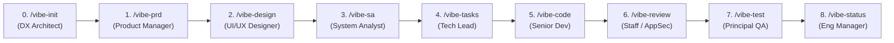

# ⚡ Vibe Coding Pipeline — Multi-Agent SDLC Framework (2026 Edition)

[](https://www.npmjs.com/package/@neko-koubou/vibe-coding-pipeline)
[](https://github.com/Neko-Koubou/vibe-coding-pipeline/releases/latest)
[](./LICENSE)
[](#-10-agent-directory-matrix)
[](#-10-agent-directory-matrix)

> **Install once. Run a complete AI engineering team (product, design, architecture, coding, review and QA) in every project on Windows, macOS and Linux.**
>
> Ships as **slash commands (`/vibe-*`)** and **Agent Skills (`SKILL.md` / `$vibe-*`)** for **Claude Code, Google Antigravity (IDE & CLI), OpenCode, OpenAI Codex + ChatGPT App, Cursor, Windsurf and Roo Code / Cline**.

🇮🇩 **[Baca dalam Bahasa Indonesia (README.id.md)](./README.id.md)**: the same guide, translated.

```bash
npx Neko-Koubou/vibe-coding-pipeline
```

---

## 📖 Table of Contents
1. [Why Vibe Coding Pipeline?](#-1-why-vibe-coding-pipeline)
2. [How It Works](#-2-how-it-works)
3. [Requirements](#-3-requirements)
4. [Installation](#-4-installation)
   - [4.1 Option A: npx (recommended)](#41-option-a-npx-recommended)
   - [4.2 Option B: permanent CLI with `npm i -g`](#42-option-b-permanent-cli-with-npm-i--g)
   - [4.3 Option C: from a clone of this repository](#43-option-c-from-a-clone-of-this-repository)
   - [4.4 Global vs Project scope](#44-global-vs-project-scope)
   - [4.5 Interactive installer walkthrough](#45-interactive-installer-walkthrough)
   - [4.6 Installer options](#46-installer-options)
   - [4.7 What gets installed](#47-what-gets-installed)
   - [4.8 Check the installation](#48-check-the-installation)
   - [4.9 Upgrading](#49-upgrading)
   - [4.10 Uninstalling](#410-uninstalling)
5. [Usage Guide](#-5-usage-guide)
   - [5.1 Golden rules](#51-golden-rules)
   - [5.2 Scenario A: from a raw idea](#52-scenario-a-from-a-raw-idea)
   - [5.3 Scenario B: you already have a `prd.md`](#53-scenario-b-you-already-have-a-prdmd)
   - [5.4 Scenario C: adding a feature to an existing codebase](#54-scenario-c-adding-a-feature-to-an-existing-codebase)
6. [Stage-by-Stage Reference](#-6-stage-by-stage-reference)
7. [Status Markers](#-7-status-markers)
8. [Context Compaction & Resume](#-8-context-compaction--resume)
9. [Command Cheat Sheet](#-9-command-cheat-sheet)
10. [Agent Directory Matrix](#-10-agent-directory-matrix)
11. [Troubleshooting & FAQ](#-11-troubleshooting--faq)
12. [Repository Layout & Releasing](#-12-repository-layout--releasing)
13. [License](#-13-license)

---

## 🎯 1. Why Vibe Coding Pipeline?

Ad-hoc prompting breaks down on real projects because of **context rot**: after 20+ messages the model forgets database constraints, invents inconsistent API routes and skips edge-case UI states. Long sessions also get **compacted** (summarized) automatically, and details disappear with the summary.

Vibe Coding Pipeline fixes this with **artifact-driven handoffs**:
- **9 specialized personas**: each command is a dedicated senior role (DX Architect, Product Manager, UI/UX Designer, System Analyst, Tech Lead, Full-Stack Developer, Staff AppSec Reviewer, QA Engineer, Engineering Manager).
- **File-system memory (`docs/vibe/`)**: every stage reads the upstream Markdown blueprints from disk and writes one structured artifact for the next stage. Decisions live in files, not in chat history.
- **Fresh context per stage**: because everything is on disk, you clear the chat between stages. Each agent starts focused and spends fewer tokens.
- **Atomic, verified coding**: `/vibe-code` implements exactly one small task, runs its Definition of Done, and records the result before you move on.
- **Compaction-safe**: progress is checkpointed on disk, so an interrupted or compacted stage resumes where it stopped instead of skipping work.

---

## 🔄 2. How It Works



| Stage | Command / Skill | Role Persona | Reads From | Writes (`docs/vibe/`) |
| :--- | :--- | :--- | :--- | :--- |
| **0. Init** | `/vibe-init` | Principal DX Architect | Repo manifests, folders & configs | `00-project-context.md` |
| **1. Product** | `/vibe-prd` | Senior Product Manager | Your idea or an existing `prd.md` | `01-prd.md` |
| **2. Design** | `/vibe-design` | Principal UI/UX Designer | `00` + `01` + existing UI code | `02-design-spec.md` |
| **3. Architecture** | `/vibe-sa` | Principal System Analyst | `00` + `01` + `02` + existing models/routes | `03-system-analysis.md` |
| **4. Planning** | `/vibe-tasks` | Technical Lead | `00` to `03` | `04-tasks.md` |
| **5. Coding** | `/vibe-code` | Senior Full-Stack Developer | `04` + `00` + `02` + `03` + `05` | Production code + `05-implementation-log.md` |
| **6. Review** | `/vibe-review` | Staff Engineer & AppSec Auditor | `00` to `05` + task commits | `06-code-review.md` |
| **7. Testing** | `/vibe-test` | Principal QA Engineer | `00` to `03` + the code | Automated tests + `07-qa-report.md` |
| **8. Status** | `/vibe-status` | Engineering Manager | Everything in `docs/vibe/` | Progress dashboard in the chat |

All artifacts live in **`docs/vibe/`** at the root of the project you are working in:

```text
docs/vibe/
├── 00-project-context.md     # /vibe-init    tech stack, conventions, verification commands
├── 01-prd.md                 # /vibe-prd     user stories (US-01...) with Gherkin criteria
├── 02-design-spec.md         # /vibe-design  design tokens, wireframes, 5-state UI matrix
├── 03-system-analysis.md     # /vibe-sa      architecture, ERD, API contracts, sequences
├── 04-tasks.md               # /vibe-tasks   ordered TASK-001... list with status markers
├── 05-implementation-log.md  # /vibe-code    one checkpoint entry per task
├── 06-code-review.md         # /vibe-review  verdict + findings
└── 07-qa-report.md           # /vibe-test    test summary + traceability matrix
```

---

## ✅ 3. Requirements

| You need | For |
| :--- | :--- |
| At least one supported AI coding agent | Claude Code, Google Antigravity, OpenCode, Codex CLI / ChatGPT app, Cursor, Windsurf or Roo Code / Cline |
| **Node.js 18+** (comes with `npm` / `npx`) | The npx / npm installer (Option A and B) |
| **git** | `npx Neko-Koubou/vibe-coding-pipeline` (downloads from GitHub), and recommended in your project because `/vibe-code` and `/vibe-review` work with per-task commits |
| **bash** (macOS, Linux, WSL, Git Bash) or **Python 3** | Only for the installers in a clone (Option C) |

---

## 🚀 4. Installation

### 4.1 Option A: npx (recommended)

No clone needed. Pick one source:

```bash
# From GitHub: always the latest main (needs git)
npx Neko-Koubou/vibe-coding-pipeline

# From npm: the latest published release (no git needed)
npx @neko-koubou/vibe-coding-pipeline@latest
```

Without options the installer asks two questions (scope and agents, see [4.5](#45-interactive-installer-walkthrough)). Skip the questions with options:

```bash
npx Neko-Koubou/vibe-coding-pipeline --global --agents claude,antigravity,codex
npx Neko-Koubou/vibe-coding-pipeline --project ./my-app --agents all
npx Neko-Koubou/vibe-coding-pipeline --yes     # Global + Claude Code, Antigravity, Codex
```

### 4.2 Option B: permanent CLI with `npm i -g`

```bash
npm i -g @neko-koubou/vibe-coding-pipeline      # from npm
# or
npm i -g Neko-Koubou/vibe-coding-pipeline       # from GitHub
```

This adds two identical commands, `vibe-pipeline` and `vibe-coding-pipeline`. They take the same options as npx:

```bash
vibe-pipeline --help
vibe-pipeline --global --agents claude,codex
vibe-pipeline uninstall
```

> **Keep the `-g`.** A plain `npm i ...` inside a project only adds the package to that project's `package.json`. It does **not** install any `/vibe-*` command. The **Install** box on the npm page always shows `npm i <package>`; npm generates it automatically.

### 4.3 Option C: from a clone of this repository

```bash
git clone https://github.com/Neko-Koubou/vibe-coding-pipeline.git
cd vibe-coding-pipeline

./install.sh            # macOS / Linux / WSL / Git Bash
python3 install.py      # any OS with Python 3
.\install.ps1           # Windows PowerShell (runs install.py, so Python 3 is required)
```

The three scripts install exactly the same files as the npx CLI. If `./install.sh` says "Permission denied", run `chmod +x install.sh` once.

### 4.4 Global vs Project scope

| | 🌍 **Global** (recommended) | 📁 **Project** |
| :--- | :--- | :--- |
| Installed into | Your user folders (`~/.claude`, `~/.codex`, `~/.gemini`, ...) | One repository (`.claude/`, `.codex/`, `.agents/`, `AGENTS.md`, ...) |
| Available in | Every project on this computer | Only that project |
| Share with your team | No | Yes: commit the generated folders |
| Extra | — | Creates `docs/vibe/` in the project |

The exact folders per agent are listed in the [Agent Directory Matrix](#-10-agent-directory-matrix).

### 4.5 Interactive installer walkthrough

The installer asks two questions.

**Step 1/2: choose the scope**

```text
STEP 1/2 — Choose the installation scope:
  [1] 🌍 GLOBAL (Recommended) — install once on macOS (arm64), available in EVERY project
  [2] 📁 SINGLE PROJECT       — install into one project folder only

👉 Choose scope [1 = Global, 2 = Project] (default: 1):
```

Press **ENTER** for Global. Choose **2** for Project; the installer then asks for the project folder (ENTER = the current folder).

**Step 2/2: choose the agents**

```text
STEP 2/2 — Choose your AI agents (multi-select | scope: GLOBAL):
  [x] 1) Claude Code (CLI & IDE)        -> ~/.claude/commands
  [x] 2) Google Antigravity (IDE & CLI) -> ~/.gemini/config/global_workflows
  [ ] 3) OpenCode (CLI / Desktop)       -> ~/.config/opencode/command
  [x] 4) Codex CLI + ChatGPT App        -> ~/.codex/prompts
  [ ] 5) Cursor (AI IDE)                -> ~/.cursor/commands
  [ ] 6) Windsurf (Agentic IDE)         -> ~/.codeium/windsurf/global_workflows
  [ ] 7) Roo Code / Cline               -> ~/.roo/commands

  • Type numbers to toggle (e.g. 1,2,4) | 'a' = all | 'n' = none
  • Press ENTER when you are done to start installing
👉 Your choice:
```

| Type | Effect |
| :--- | :--- |
| Numbers, e.g. `3` or `1,5` or `3 5` | Toggle those agents on/off |
| `a` | Select all agents |
| `n` | Clear the selection |
| **ENTER** | Install the checked agents (at least one is required) |

Claude Code, Antigravity and Codex are checked by default.

### 4.6 Installer options

| Option | npx / `vibe-pipeline` | `install.sh` | `install.py` | `install.ps1` |
| :--- | :--- | :--- | :--- | :--- |
| Global scope | `-g`, `--global` | `-g`, `--global` | `-g`, `--global` | `-Scope global` |
| Project scope | `-p [dir]`, `--project [dir]` | `-p [dir]`, `--project [dir]` | `-p`, `--project` (folder via `-t`) | `-Scope project` |
| Project folder | `-t <dir>`, `--target <dir>` | `-t <dir>`, `--target <dir>` | `-t <dir>`, `--target <dir>` | `-Target <dir>` |
| Agents | `-a <list>`, `--agents <list>` | `-a <list>`, `--agents <list>` | `-a <list>`, `--agents <list>` | `-Agents <list>` |
| No prompts, use defaults | `-y`, `--yes` | — | — | — |
| Version / help | `-v`, `-h` | `-h` | `-h` | — |
| Uninstall (global) | `uninstall` | `./uninstall.sh` | `python3 uninstall.py` | `.\uninstall.ps1` |

Agent names for `--agents` (comma- or space-separated):

| # | Key | Also accepted by npx & `install.sh` | Agent |
| :--- | :--- | :--- | :--- |
| 1 | `claude` | `claude-code` | Claude Code |
| 2 | `antigravity` | `ag` | Google Antigravity (IDE & CLI) |
| 3 | `opencode` | — | OpenCode |
| 4 | `codex` | `chatgpt` | Codex CLI + ChatGPT App |
| 5 | `cursor` | — | Cursor |
| 6 | `windsurf` | — | Windsurf |
| 7 | `roocode` | `roo`, `cline` | Roo Code / Cline |
| — | `all` | — | All seven agents |

`install.py` accepts the keys and the numbers. With `--yes`, the npx CLI uses Global scope and Claude Code, Antigravity and Codex, unless you also pass `--global`/`--project` or `--agents`.

### 4.7 What gets installed

| What | Details |
| :--- | :--- |
| **9 slash commands / workflows / prompts** | `vibe-init.md` … `vibe-status.md`, copied into each agent's command folder |
| **9 Agent Skills** | `vibe-*/SKILL.md` folders, for agents that support skills (not Windsurf or Roo Code) |
| **Rules block** | The always-on pipeline protocol, including the compaction rules and a **Compact Instructions** section. In shared files (`CLAUDE.md`, `AGENTS.md`, `GEMINI.md`, `global_rules.md`) it sits between `<!-- vibe-pipeline:start -->` and `<!-- vibe-pipeline:end -->`; the rest of the file is never touched. Dedicated files (`vibe-pipeline.md`, `vibe-pipeline.mdc`) are simply overwritten. |
| **`docs/vibe/`** | Created empty in Project scope; the stages fill it |

### 4.8 Check the installation

1. Restart your agent or open a new session so it loads the new commands.
2. Type `/vibe-` (or `$vibe-` in Codex): you should see the 9 stages.
3. Or check the files directly, for example:

```bash
ls ~/.claude/skills | grep vibe     # Claude Code, global install
ls ~/.codex/skills | grep vibe      # Codex, global install
```

### 4.9 Upgrading

Run the installer again with the same scope and agents:

```bash
npx Neko-Koubou/vibe-coding-pipeline              # fetches the latest main every time
npx @neko-koubou/vibe-coding-pipeline@latest      # the latest npm release
```

From a clone, `git pull` first and re-run `install.sh` / `install.py`. Commands and skills are overwritten. The Vibe block in shared rules files is replaced in place, and your own content in those files is kept. Restart your agent afterwards.

### 4.10 Uninstalling

```bash
npx Neko-Koubou/vibe-coding-pipeline uninstall    # any OS with Node.js
./uninstall.sh                                     # macOS / Linux / Git Bash
.\uninstall.ps1                                    # Windows PowerShell
python3 uninstall.py                               # any OS with Python 3
```

**Removed** (global install, all seven agents): every `vibe-*` command, workflow, prompt and skill, Cursor's `vibe-pipeline.mdc`, and files left behind by older Antigravity installers.

**Kept**, so you can remove them by hand if you want:
- the Vibe block inside `~/.claude/CLAUDE.md`, `~/.codex/AGENTS.md`, `~/.gemini/GEMINI.md`, `~/.gemini/config/GEMINI.md`, `~/.config/opencode/AGENTS.md` and `~/.codeium/windsurf/memories/global_rules.md`: delete everything from `<!-- vibe-pipeline:start -->` to `<!-- vibe-pipeline:end -->` (older installs have no markers; their block starts at `# Vibe Coding Pipeline — Multi-Agent Engineering Protocol`);
- `~/.roo/rules/vibe-pipeline.md`;
- **Project installs**: delete the `vibe-*` files from the project folders in the [matrix](#-10-agent-directory-matrix);
- your `docs/vibe/` artifacts.

---

## 🧭 5. Usage Guide

### 5.1 Golden rules

1. **One stage per chat.** Clear the context between stages (`/clear` in Claude Code, or start a new chat/session in your agent). Every stage reads what it needs from `docs/vibe/`.
2. **Review every artifact before moving on.** Edit the file if something is wrong; the next stage reads the file, not the chat.
3. **Commit after every `/vibe-code` task** and keep the task ID in the message (`feat: complete TASK-003`). `/vibe-review` finds work through those commits.
4. **Interrupted or compacted? Run the same command again.** Each stage continues from its on-disk checkpoint (see [section 8](#-8-context-compaction--resume)).
5. **Lost? Run `/vibe-status`.** It shows progress and the next command to run.

### 5.2 Scenario A: from a raw idea

1. **Set up the project context**
   ```text
   /vibe-init Next.js 15 App Router, Tailwind CSS, Go ConnectRPC backend, PostgreSQL, Redis
   ```
   Writes `00-project-context.md`: tech stack, folder conventions and the exact build/lint/test commands. In an empty folder without a stack, it proposes one or asks up to 3 questions.

2. **Write the PRD** (clear the chat first)
   ```text
   /vibe-prd Build a real-time multiplayer quiz platform with host lobby, QR join, live leaderboard, and Redis state sync
   ```
   Answer the 3–5 clarifying questions if asked (or add `--auto` to let it use sensible defaults). Writes `01-prd.md` with numbered user stories `US-01`, `US-02`… and Gherkin acceptance criteria.

3. **Design the UI** (clear the chat)
   ```text
   /vibe-design Modern playful dark theme, mobile-first participant screen, desktop projector view for host
   ```
   Writes `02-design-spec.md`: design tokens, ASCII wireframes for every screen, component props and the 5-state UI matrix. Skip this stage for backend-only work.

4. **Design the system** (clear the chat)
   ```text
   /vibe-sa
   ```
   Writes `03-system-analysis.md`: architecture diagram, database ERD and tables, every API contract with its error matrix, and sequence diagrams.

5. **Plan the tasks** (clear the chat)
   ```text
   /vibe-tasks
   ```
   Writes `04-tasks.md`: atomic `TASK-001`, `TASK-002`… in 6 phases, each touching 1–4 files with a Definition of Done.

6. **Build, one task per chat** (clear the chat before each task)
   ```text
   /vibe-code
   ```
   Picks the next eligible task (or `/vibe-code TASK-003`, or `/vibe-code phase 2`), implements it, runs its verification, marks it `[x]` and logs it in `05-implementation-log.md`. Then commit, clear, and run `/vibe-code` again.

7. **Review the finished phase** (clear the chat)
   ```text
   /vibe-review
   /vibe-review --fix
   ```
   Writes `06-code-review.md` with a verdict and findings. `--fix` repairs the `[CRITICAL]` and `[MAJOR]` findings one by one.

8. **Test** (clear the chat)
   ```text
   /vibe-test
   ```
   Writes and runs unit, integration and E2E tests, then `07-qa-report.md` with a traceability matrix `US-xx → test → PASS/FAIL`.

9. **Check progress any time**
   ```text
   /vibe-status
   ```

### 5.3 Scenario B: you already have a `prd.md`

If you wrote a `prd.md` yourself (or exported one from Notion, Google Docs or ChatGPT), there are two ways in.

**Option 1: let `/vibe-prd` import and normalize it (recommended).** Hand-written PRDs usually lack the `US-xx` IDs, Given/When/Then criteria and edge cases that `/vibe-sa`, `/vibe-tasks` and `/vibe-test` rely on.

1. Put `prd.md` in your project folder.
2. Run `/vibe-init`.
3. Clear the chat, then run:
   ```text
   /vibe-prd prd.md
   ```
   In agents with file mentions you can write `/vibe-prd @prd.md`. Running `/vibe-prd` with no argument also imports `prd.md` / `PRD.md` from the project root.
4. The Product Manager keeps 100% of your features and constraints and adds what is missing: `US-*` IDs, Gherkin criteria, a Mermaid user flow and edge cases. The result is `docs/vibe/01-prd.md`.
5. Continue with `/vibe-design` → `/vibe-sa` → `/vibe-tasks` → `/vibe-code`.

**Option 2: skip `/vibe-prd` (fast track)**, if your PRD is already detailed:

1. Copy it into place:
   ```bash
   mkdir -p docs/vibe
   cp prd.md docs/vibe/01-prd.md
   ```
2. Run `/vibe-init`.
3. Go straight to `/vibe-design` (or `/vibe-sa` for backend-only work).

Even if you forget step 1, `/vibe-design` and `/vibe-sa` fall back to `prd.md` / `PRD.md` in the project root when `01-prd.md` is missing.

### 5.4 Scenario C: adding a feature to an existing codebase

1. Open the repository and run `/vibe-init`. It reads your manifests (`package.json`, `go.mod`, `composer.json`, …), folder structure, linters and database setup.
2. Run `/vibe-prd <new feature description>` (or `/vibe-prd feature-prd.md`). If `01-prd.md` already exists, it is revised in place: existing `US-*` IDs stay, new stories get new IDs.
3. Run `/vibe-design` (if there is UI) and `/vibe-sa`. The System Analyst reads your existing models, migrations and routes so the new schema and endpoints fit without breaking existing code.
4. Run `/vibe-tasks`. If `04-tasks.md` already exists, finished and in-progress tasks keep their IDs and status, and new tasks are added.
5. Continue with `/vibe-code` → `/vibe-review` → `/vibe-test`.

---

## 📚 6. Stage-by-Stage Reference

### 6.1 `/vibe-init`: Principal DX Architect
- **Argument (optional):** stack or project notes, e.g. `/vibe-init Laravel 12, Nuxt 3, PostgreSQL`.
- **Does:** creates `docs/vibe/`, detects Greenfield (new) vs Brownfield (existing code), scans manifests, folder structure, linters and env/docker files, and notes any existing `prd.md`. For a Greenfield project without a stack, it proposes one or asks up to 3 questions.
- **Writes `00-project-context.md`:** project identity and architecture style; tech stack matrix (languages, frontend, backend & API protocol, database/ORM/cache/broker, test frameworks & linters); naming conventions and module boundaries; the exact install/build/typecheck/lint/test commands; global non-negotiables (no `any`, no unparameterized SQL, no hardcoded secrets).
- **Never:** writes feature code.
- **Next:** `/vibe-prd`.

### 6.2 `/vibe-prd`: Senior Product Manager
- **Argument:** a raw idea, **or** a file path (`prd.md`, `@prd.md`, `docs/prd.md`, `requirements.md`). Empty + `prd.md` in the root = import mode. Add `--auto` to skip the questions.
- **Does:** asks 3–5 high-leverage clarifying questions (with recommended defaults) when roles, scope or business rules are unclear.
- **Writes `01-prd.md`:** executive summary & problem; personas & role permissions; MoSCoW scope (P0 MVP / P1 / P2 / out of scope); numbered user stories `US-01…` with Given/When/Then for happy and negative paths; Mermaid `flowchart TD` user flow; business rules, validation & edge cases; non-functional requirements (latency, security, accessibility, audit logging).
- **Re-run:** revises in place and keeps `US-*` IDs stable.
- **Never:** writes implementation code (it covers WHAT and WHY).
- **Next:** `/vibe-design` for UI work, `/vibe-sa` for backend-only work.

### 6.3 `/vibe-design`: Principal UI/UX Designer
- **Argument (optional):** style direction or UI library, e.g. `/vibe-design Clean minimalist dashboard using shadcn/ui`.
- **Does:** reads `01-prd.md` (falls back to a root `prd.md`), and inspects your existing stylesheets, Tailwind config and components to stay consistent.
- **Writes `02-design-spec.md`:** aesthetic direction & principles; design tokens (semantic colors for light and dark mode, typography scale, spacing, grid, radius, elevation); ASCII wireframes for every screen and modal on desktop and mobile; component hierarchy & props contract; the **5-state matrix** for every screen (Loading/Skeleton, Empty, Populated, Partial/Edge, Error/Offline); micro-interactions and WCAG 2.1 AA (keyboard navigation, focus traps, ARIA).
- **Never:** writes production frontend code.
- **Next:** `/vibe-sa`.

### 6.4 `/vibe-sa`: Principal System Analyst
- **Argument (optional):** architecture constraints, e.g. `/vibe-sa Use ConnectRPC, PostGIS, and Redis caching`.
- **Does:** reads `00`, `01` (or root `prd.md`) and `02`, and inspects your models, migrations, routes, services and middleware.
- **Writes `03-system-analysis.md`:** Mermaid architecture diagram and the exact file/module mapping; Mermaid ERD plus every table (columns, types, nullability, defaults, foreign keys with `ON DELETE`, composite/unique indexes); a contract for **every** endpoint (method, path/RPC, auth/RBAC, rate limit, headers, query, body with validation rules, success JSON, error matrix `400/401/403/404/409/422/500`); sequence diagrams for core flows; transactions, idempotency, locking and cache invalidation; OWASP Top 10 notes and Architecture Decision Records.
- **Rules:** no vague placeholders such as "add fields as needed". On re-run, section headings stay stable because tasks link to them.
- **Next:** `/vibe-tasks`.

### 6.5 `/vibe-tasks`: Technical Lead
- **Argument (optional):** sizing or phase hints.
- **Does:** checks that every user story, screen, table and endpoint is covered by a task.
- **Writes `04-tasks.md`:** an execution summary, a Mermaid dependency graph, the status legend, and tasks in 6 phases: (1) foundation, config & shared types; (2) migrations, models & repositories; (3) domain services & API endpoints; (4) design tokens, base UI & state; (5) feature screens, API integration & the 5 UI states; (6) hardening & polish. Each task uses this template:
  ```markdown
  ### - [ ] TASK-001: <Concise Action Title>
  - **Traceability**: `US-01`, `03-system-analysis.md#section`
  - **Depends On**: `None` (or `TASK-00X`)
  - **Target Files**:
    - `CREATE` `path/to/new_file.ext`
    - `MODIFY` `path/to/existing_file.ext`
  - **Implementation Specs**:
    - Step-by-step technical instructions referencing exact schemas/contracts.
  - **Definition of Done (Verification)**:
    - Exact command or assertion to verify before marking `[x]`.
  ```
- **Rules:** each task touches 1–4 tightly coupled files so it fits in one context window. A re-run keeps existing task IDs and their `[x]` / `[~]` / `[!]` status.
- **Next:** `/vibe-code`.

### 6.6 `/vibe-code`: Senior Full-Stack Developer
- **Argument (optional):** nothing (next task), a task ID (`TASK-003`) or a phase (`phase 2`).
- **Which task:** an unfinished `[~]` task is always resumed first (if there are several, or you named a different task, it asks). Otherwise: the task you named, or the first eligible task of the phase, or the first `[ ]` task whose dependencies are all `[x]`. If dependencies are unfinished or nothing is eligible, it stops and tells you why.
- **Checkpoint:** before writing code it marks the task `[~]` and adds this entry to `05-implementation-log.md`, then updates it after every file and every verification attempt:
  ```markdown
  ## TASK-003: <title> — IN PROGRESS
  - **Started**: <timestamp>
  - **Plan**: <target files>
  - **Done so far**: none yet
  - **Verification**: pending
  ```
- **Implementation rules:** exact names, types, routes, status codes and props from `02`/`03`; strict typing (zero `any`); structured error handling; parameterized queries; input validation; all 5 UI states; no `TODO` stubs or debug logs; stays within the task's Target Files.
- **Verification:** runs the task's Definition of Done plus the typecheck/lint commands from `00`. Success → `[x]` and a `DONE` log entry (files touched, command, result). Still failing after 3 focused fix attempts, or blocked by something outside the task (missing secret, service, unfinished dependency) → `[!]` and a `BLOCKED` log entry with the exact error. It never marks `[x]` on a failing check.
- **One task per run:** it stops after one task. Commit, clear, and run `/vibe-code` again.

### 6.7 `/vibe-review`: Staff Engineer & AppSec Auditor
- **Argument (optional):** files or task IDs to narrow the review, and/or `--fix`.
- **Scope:** because every task is committed, it does not rely on `git diff` alone. It reviews every `[x]` task not yet listed under **Reviewed Tasks**: the files from `05-implementation-log.md`, the commits found with `git log --grep "TASK-"`, plus uncommitted changes.
- **Audits 4 pillars:** blueprint compliance (schemas, status codes, columns/indexes, 5 UI states); security (OWASP Top 10: access control/IDOR, injection, XSS, secret leaks, missing validation or rate limits); performance & concurrency (N+1, missing transactions, races, leaks); code quality (types, errors, modularity).
- **Writes `06-code-review.md`:** a verdict (`APPROVED`, `APPROVED WITH MINOR NOTES` or `CHANGES REQUESTED`), the cumulative **Reviewed Tasks** list, and findings tagged `[CRITICAL]`, `[MAJOR]` or `[MINOR]`, each `[OPEN]` with `File:Line` and a concrete fix.
- **`--fix`:** if `06-code-review.md` already has open `[CRITICAL]`/`[MAJOR]` findings, it skips the re-audit and fixes them one at a time, switching each to `[RESOLVED]` right away. Then it runs the verification commands and updates the verdict. `[MINOR]` findings are left for you.
- **Next:** `/vibe-review --fix` if needed, then `/vibe-test`.

### 6.8 `/vibe-test`: Principal QA Engineer
- **Argument (optional):** a module, a user story (`US-01`) or a test type.
- **Does:** first writes `07-qa-report.md` as `DRAFT` with one traceability row per in-scope user story set to `PENDING`. Then writes and runs unit tests (domain logic, boundaries, negative inputs), integration/API tests (`200/201`, `400/422`, `401/403`, `404/409`) and component/E2E tests (user journeys and UI states), updating each row as soon as its tests have run.
- **Fix loop:** fixes broken tests or application bugs until green. A failure that persists after 3 focused attempts is recorded as `FAIL` with its root cause instead of looping.
- **Writes `07-qa-report.md` (COMPLETE):** execution summary (passed, failed, duration), the Requirement Traceability Matrix `US-XX → test file & case → PASS/FAIL`, verified edge cases and remaining manual checks.
- **Next:** `/vibe-status`.

### 6.9 `/vibe-status`: Engineering Manager
- **Argument (optional):** `--detailed` lists every task with its status.
- **Shows:** a stage health table (artifacts still `DRAFT` are flagged as interrupted); per-phase progress with a progress bar (`[████████░░] 80%`), counting only real task headings; interrupted (`[~]`) and blocked (`[!]`, with the reason from the log) work; the review and QA gate; and the recommended next command (an unfinished `[~]` task always comes first). With no `docs/vibe/` artifacts yet, it recommends `/vibe-init`.

---

## 🚦 7. Status Markers

| Where | Marker | Meaning |
| :--- | :--- | :--- |
| `04-tasks.md` | `- [ ]` | Pending |
| | `- [~]` | In progress (or interrupted: `/vibe-code` resumes it) |
| | `- [x]` | Completed and verified |
| | `- [!]` | Blocked: the reason is in `05-implementation-log.md` |
| Top of `00`–`04` and `07` | `> **Status**: DRAFT` / `COMPLETE` | The stage is still writing / finished. Re-run a `DRAFT` stage to finish it |
| `05-implementation-log.md` | `IN PROGRESS` / `DONE` / `BLOCKED` | Heading of each task entry |
| `06-code-review.md` | `[OPEN]` / `[RESOLVED]` | State of each finding |
| `07-qa-report.md` | `PENDING` / `PASS` / `FAIL` | State of each traceability row |

---

## 🧠 8. Context Compaction & Resume

Agents automatically compact (summarize) long conversations. When that happens in the middle of a stage, chat memory, and sometimes the `/vibe-*` instructions themselves, can be summarized away. Every stage therefore keeps its progress **on disk**:

| Stage | On-disk checkpoint | After a compaction or interruption |
| :--- | :--- | :--- |
| `/vibe-code` | `[~]` marker in `04-tasks.md` + `IN PROGRESS` entry in `05-implementation-log.md` | Run `/vibe-code` again: it resumes the `[~]` task instead of skipping to the next one |
| `/vibe-review --fix` | Each finding flips `[OPEN]` → `[RESOLVED]` in `06-code-review.md` | Run `/vibe-review --fix` again: it continues with the remaining `[OPEN]` findings |
| `/vibe-test` | RTM rows go `PENDING` → `PASS`/`FAIL` in `07-qa-report.md` | Run `/vibe-test` again: it continues with the `PENDING` rows |
| `/vibe-init` … `/vibe-tasks` | `> **Status**: DRAFT` until the artifact is `COMPLETE` | Run the stage again: it finishes the missing sections |

The installed rules file (`CLAUDE.md` / `AGENTS.md` / `.mdc`) stays loaded after a compaction. It tells the agent to re-read `docs/vibe/` and `git status` before continuing, never to start a new task while one is `[~]`, and it includes a **Compact Instructions** section that tells the summary what to keep: the active stage, the active `TASK-XXX`, files touched, the last verification result and the next step.

---

## 📋 9. Command Cheat Sheet

| Command | Arguments | Example |
| :--- | :--- | :--- |
| `/vibe-init` | `[stack or project notes]` | `/vibe-init Laravel 12, Nuxt 3, PostgreSQL, Tailwind` |
| `/vibe-prd` | `<idea or file path> [--auto]` | `/vibe-prd prd.md` · `/vibe-prd Build an e-wallet transfer API` |
| `/vibe-design` | `[style / UI library]` | `/vibe-design Clean minimalist dashboard using shadcn/ui` |
| `/vibe-sa` | `[architecture constraints]` | `/vibe-sa Use ConnectRPC, PostGIS, and Redis caching` |
| `/vibe-tasks` | `[sizing or phase hints]` | `/vibe-tasks` |
| `/vibe-code` | `[TASK-ID or "phase N"]` | `/vibe-code` · `/vibe-code TASK-003` · `/vibe-code phase 2` |
| `/vibe-review` | `[files or task IDs] [--fix]` | `/vibe-review` · `/vibe-review --fix` |
| `/vibe-test` | `[module, US-ID or test type]` | `/vibe-test` · `/vibe-test US-01` |
| `/vibe-status` | `[--detailed]` | `/vibe-status` · `/vibe-status --detailed` |

**How to call a stage in each agent:**
- **Claude Code, Google Antigravity, OpenCode, Cursor, Windsurf, Roo Code / Cline:** `/vibe-prd ...`. In Claude Code the skill and the command share a name; the skill is used.
- **Codex CLI / IDE and the ChatGPT app:** `$vibe-prd ...` (skill, recommended). The prompts in `~/.codex/prompts` also work as `/prompts:vibe-prd`, but OpenAI has deprecated custom prompts in favor of skills.
- **File mentions:** where your agent supports them, `@file` works in arguments, e.g. `/vibe-prd @prd.md`.

---

## 📁 10. Agent Directory Matrix

| AI Coding Agent | Global Commands / Workflows | Global Skills (`SKILL.md`) | Global Rules | Project Paths |
| :--- | :--- | :--- | :--- | :--- |
| **Claude Code** | `~/.claude/commands/` | `~/.claude/skills/vibe-*/` | `~/.claude/CLAUDE.md` | `.claude/{commands,skills}/` + `CLAUDE.md` |
| **Google Antigravity (IDE & CLI)** | `~/.gemini/config/global_workflows/` & `workflows/` | `~/.gemini/config/skills/vibe-*/` | `~/.gemini/GEMINI.md` & `~/.gemini/config/GEMINI.md` | `.agents/` & `.agent/` `{workflows,skills,rules}/` + `AGENTS.md` |
| **OpenCode** | `~/.config/opencode/command/` & `commands/` | `~/.config/opencode/skills/vibe-*/` | `~/.config/opencode/AGENTS.md` | `.opencode/{command,commands,skills}/` + `AGENTS.md` |
| **Codex CLI + ChatGPT App** | `~/.codex/prompts/` | `~/.codex/skills/vibe-*/` | `~/.codex/AGENTS.md` | `.codex/{prompts,skills}/` + `AGENTS.md` |
| **Cursor** | `~/.cursor/commands/` | `~/.cursor/skills/vibe-*/` | `~/.cursor/rules/vibe-pipeline.mdc` | `.cursor/{commands,skills,rules}/` |
| **Windsurf** | `~/.codeium/windsurf/global_workflows/` & `~/.windsurf/workflows/` | — | `~/.codeium/windsurf/memories/global_rules.md` | `.windsurf/{workflows,rules}/` |
| **Roo Code / Cline** | `~/.roo/commands/` | — | `~/.roo/rules/vibe-pipeline.md` | `.roo/{commands,rules}/` + `.clinerules/workflows/` |

- `~/.config` follows `XDG_CONFIG_HOME` when it is set. On Windows, OpenCode commands are also copied to `%APPDATA%\opencode\`.
- Windsurf and Roo Code / Cline do not use Agent Skills; they get the commands/workflows and the rules only.

---

## 🛟 11. Troubleshooting & FAQ

**The `/vibe-*` commands do not show up.**
Restart the agent or open a new session. A **Project** install only works inside that project folder. Check that the files exist in the folders from the [matrix](#-10-agent-directory-matrix).

**`npx Neko-Koubou/vibe-coding-pipeline` fails with a git error.**
That form downloads from GitHub and needs `git`. Install git, or use `npx @neko-koubou/vibe-coding-pipeline@latest`.

**I ran `npm i ...` and nothing was installed.**
Without `-g`, npm only adds a dependency to the current project. Use `npx ...` or `npm i -g ...` (see [4.2](#42-option-b-permanent-cli-with-npm-i--g)).

**"No terminal for interactive prompts".**
The installer is running without a terminal (CI, a script, piped input). Pass `--global` or `--project` together with `--agents`, or use `--yes`.

**"… has a modified Vibe Coding Pipeline block; update it manually".**
The Vibe block in that file was edited by hand, so the installer will not overwrite it. Replace that section with the content of `rules/AGENTS.md` (or `rules/CLAUDE.md`) from this repository.

**The agent skipped a task, or two tasks are `[~]`.**
Run `/vibe-status`, then `/vibe-code TASK-XXX` for the task that should continue. Fix any wrong markers in `04-tasks.md` by hand; the files are plain Markdown.

**A task is stuck at `[!]` Blocked.**
Read its `BLOCKED` entry in `05-implementation-log.md` (the exact error and what is needed), fix the cause (env var, service, dependency), then run `/vibe-code TASK-XXX`.

**`/vibe-review` finds nothing to review.**
It looks for commits whose message contains `TASK-` and for the files listed in the log. Commit with the task ID in the message, or name the files/tasks: `/vibe-review TASK-004 TASK-005`.

**An artifact still says `DRAFT`.**
The stage was interrupted. Run the same stage again; it finishes the missing sections.

**npm says `vibe-coding-pipeline` is deprecated.**
The package moved to `@neko-koubou/vibe-coding-pipeline`. Use `npx @neko-koubou/vibe-coding-pipeline@latest` or `npx Neko-Koubou/vibe-coding-pipeline`.

**Does it work offline / with other models?**
The prompts are plain Markdown, so they work with any model your agent uses. Installing via npx needs network access; running the stages does not depend on this package.

---

## 🧩 12. Repository Layout & Releasing

| Path | Purpose |
| :--- | :--- |
| `skills/vibe-*/SKILL.md` | **Source of truth** for each stage (Agent Skills format: `name` + `description` frontmatter) |
| `prompts/vibe-*.md` | Same body as the skill, with `description` + `argument-hint` frontmatter; installed as commands, workflows and prompts |
| `rules/` | The always-on rules block: `CLAUDE.md`, `AGENTS.md`, and `vibe-pipeline.mdc` for Cursor |
| `bin/vibe-pipeline.js` | The npx / npm CLI (no dependencies) |
| `install.sh`, `install.py`, `install.ps1` | Installers for a clone |
| `uninstall.sh`, `uninstall.py`, `uninstall.ps1` | Global uninstallers |
| `dist/` | Ready-made per-agent copies of the files above, for copying by hand |
| `.github/workflows/publish-github-packages.yml` | Publishes every GitHub Release to GitHub Packages |

**Changing a stage:** edit `skills/vibe-<stage>/SKILL.md`, give `prompts/vibe-<stage>.md` the same body, and refresh the copies in `dist/`.

**Releasing a new version:**
1. Bump `version` in `package.json` in a pull request and merge it.
2. Run `npm publish` from an up-to-date `main` (requires npm 2FA).
3. Publish a GitHub Release named `vX.Y.Z` (matching `package.json`) on the merge commit. The workflow then publishes the same version to GitHub Packages.

---

## 📄 13. License

MIT License: free for personal and commercial use. See [LICENSE](./LICENSE).
