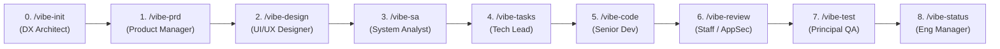

# ⚡ Vibe Coding Pipeline — Multi-Agent SDLC Framework (2026 Edition)

[](#license)
[](#2026-agent-directory-matrix-global--project)
[](#2026-agent-directory-matrix-global--project)

> **Install once globally. Orchestrate a complete AI Engineering Team across every project on Windows, macOS, and Linux.**
>
> Supports both **Slash Commands (`/vibe-*`)** and the **2026 Agent Skills Standard (`SKILL.md` / `$vibe-*`)** across **Claude Code, Google Antigravity (White Icon IDE), OpenCode, OpenAI Codex + ChatGPT App, Cursor, Windsurf, and Roo Code / Cline**.

🇮🇩 **[Baca Panduan Lengkap Bahasa Indonesia (README.id.md)](./README.id.md)**

---

## 📖 Table of Contents
1. [Why Vibe Coding Pipeline?](#-why-vibe-coding-pipeline)
2. [Pipeline Architecture & Roles](#-pipeline-architecture--roles)
3. [Quick Installation (Global & Project)](#-quick-installation-global--project)
4. [Complete Usage Guide (3 Real-World Scenarios)](#-complete-usage-guide-3-real-world-scenarios)
   - [Scenario A: Starting from a Raw Idea (From Scratch)](#scenario-a-starting-from-a-raw-idea-from-scratch)
   - [Scenario B: You Already Have an Existing `prd.md` File](#scenario-b-you-already-have-an-existing-prdmd-file)
   - [Scenario C: Adding a Feature to an Existing Codebase (Brownfield)](#scenario-c-adding-a-feature-to-an-existing-codebase-brownfield)
5. [Command Reference & Cheat Sheet](#-command-reference--cheat-sheet)
6. [2026 Agent Directory Matrix (Global & Project)](#-2026-agent-directory-matrix-global--project)

---

## 🎯 Why Vibe Coding Pipeline?

Ad-hoc prompting fails on real engineering projects because of **Context Rot**: after 20+ messages, the LLM forgets database constraints, invents inconsistent API routes, and skips edge-case UI states.

**Vibe Coding Pipeline** solves this using **Artifact-Driven State Handoffs**:
- **9 Specialized Personas**: Each command acts as a dedicated senior role (DX Architect, Product Manager, Principal UI/UX Designer, System Analyst, Tech Lead, Senior Full-Stack Developer, Staff AppSec Reviewer, Principal QA Engineer, Engineering Manager).
- **File-System Memory (`docs/vibe/`)**: Every stage reads upstream Markdown blueprints from disk and writes a structured artifact for the next stage.
- **Fresh Context Window (`/clear`)**: Because all decisions are persisted in `docs/vibe/00` through `07`, you clear your chat between stages so every agent runs with 100% focus and minimal token usage.

---

## 🏗️ Pipeline Architecture & Roles



| Stage | Command / Skill | Role Persona | Reads From | Writes Artifact (`docs/vibe/`) |
| :--- | :--- | :--- | :--- | :--- |
| **0. Init** | `/vibe-init` | Principal DX Architect | Repo manifests & configs | `00-project-context.md` |
| **1. Product** | `/vibe-prd` | Senior Product Manager | Idea or existing `prd.md` | `01-prd.md` |
| **2. Design** | `/vibe-design` | Principal UI/UX Designer | `00` + `01-prd.md` | `02-design-spec.md` |
| **3. Architecture** | `/vibe-sa` | Principal System Analyst | `00` + `01` + `02-design-spec.md` | `03-system-analysis.md` |
| **4. Planning** | `/vibe-tasks` | Technical Lead | `00` + `01` + `02` + `03` | `04-tasks.md` |
| **5. Coding** | `/vibe-code` | Senior Full-Stack Developer | `04-tasks.md` + `02` + `03` | Production Code + `05-implementation-log.md` |
| **6. Review** | `/vibe-review` | Staff Engineer & AppSec | `git diff` + `01`..`04` | `06-code-review.md` |
| **7. Testing** | `/vibe-test` | Principal QA Engineer | Code + `01` + `03` | Automated Tests + `07-qa-report.md` |
| **8. Status** | `/vibe-status` | Engineering Manager | All `docs/vibe/*.md` | Live Terminal Progress Dashboard |

---

## 🚀 Quick Installation (Global & Project)

### Interactive Installer (macOS / Linux / WSL / Windows Git Bash)
```bash
git clone https://github.com/<your-username>/vibe-coding-pipeline.git
cd vibe-coding-pipeline
./install.sh
```

### Windows PowerShell / Universal Python 3
```powershell
python3 install.py
# or in PowerShell:
.\install.ps1
```

### Non-Interactive CLI Flags
```bash
# Install GLOBALLY for Claude Code, Antigravity, OpenCode, and Codex/ChatGPT App
./install.sh --global --agents claude,antigravity,opencode,codex

# Install GLOBALLY for ALL 7 agents
./install.sh --global --agents all

# Install into a SINGLE project directory
./install.sh --project /path/to/my-project --agents claude,antigravity
```

---

## 🛠️ Complete Usage Guide (3 Real-World Scenarios)

### Scenario A: Starting from a Raw Idea (From Scratch)

1. **Initialize Project Context**:
   ```text
   /vibe-init Next.js 15 App Router, Tailwind CSS, Go ConnectRPC backend, PostgreSQL, Redis
   ```
   *(Generates `docs/vibe/00-project-context.md`)*

2. **Create the PRD from Your Idea**:
   Clear chat (`/clear`), then run:
   ```text
   /vibe-prd Build a real-time multiplayer quiz platform with host lobby, QR join, live leaderboard, and Redis state sync
   ```
   *(Answer the 3–5 clarifying questions if asked. Generates `docs/vibe/01-prd.md`)*

3. **Generate UI/UX Specification**:
   Clear chat (`/clear`), then run:
   ```text
   /vibe-design Modern playful dark theme, mobile-first participant screen, desktop projector view for host
   ```
   *(Generates `docs/vibe/02-design-spec.md` with wireframes, tokens, and 5 UI states)*

4. **Generate System Analysis, DB ERD & API Contracts**:
   Clear chat (`/clear`), then run:
   ```text
   /vibe-sa
   ```
   *(Generates `docs/vibe/03-system-analysis.md`)*

5. **Break Down into Atomic Engineering Tasks**:
   Clear chat (`/clear`), then run:
   ```text
   /vibe-tasks
   ```
   *(Generates `docs/vibe/04-tasks.md`)*

6. **Execute Tasks One by One**:
   Clear chat (`/clear`), then run:
   ```text
   /vibe-code
   ```
   *(Or target a specific task: `/vibe-code TASK-001`. Commit your changes after each task!)*

7. **Audit Security & Architecture, Then Run Automated QA**:
   ```text
   /vibe-review --fix
   /vibe-test
   /vibe-status
   ```

---

### Scenario B: You Already Have an Existing `prd.md` File

If you already wrote a `prd.md` (or exported one from Notion/Google Docs/ChatGPT), you have **two easy ways** to feed it into the pipeline:

#### Option 1: Let `/vibe-prd` Import & Normalize Your `prd.md` (Recommended)
Why? Because raw PRDs often lack numbered User Story IDs (`US-01`, `US-02`), Gherkin acceptance criteria, or edge-case rules needed by `/vibe-sa` and `/vibe-test`.

1. Place your `prd.md` file in your project folder.
2. Run `/vibe-init` to scan your project.
3. Run `/vibe-prd` and point it to your file:
   ```text
   /vibe-prd prd.md
   ```
   *(Or in agents supporting `@` file mentions: `/vibe-prd @prd.md`)*
4. The Product Manager agent will read your `prd.md`, preserve 100% of your features, enrich it with traceable `US-*` IDs and Mermaid flows, and save it to `docs/vibe/01-prd.md`.
5. Continue normally with `/vibe-design` $\rightarrow$ `/vibe-sa` $\rightarrow$ `/vibe-tasks` $\rightarrow$ `/vibe-code`!

#### Option 2: Skip `/vibe-prd` Directly (Fast Track)
If your `prd.md` is already super detailed and you want to jump straight to UI/UX Design or System Analysis:
1. Copy or move your `prd.md` to `docs/vibe/01-prd.md`:
   ```bash
   mkdir -p docs/vibe
   cp prd.md docs/vibe/01-prd.md
   ```
2. Run `/vibe-init` (so the agents know your tech stack).
3. Jump straight to **`/vibe-design`** (or **`/vibe-sa`** if backend-only)!
   *(Note: `/vibe-design` and `/vibe-sa` also have a smart fallback—if `docs/vibe/01-prd.md` is missing, they automatically check if `prd.md` exists in your project root!)*

---

### Scenario C: Adding a Feature to an Existing Codebase (Brownfield)

1. Open your existing repository and run **`/vibe-init`**. It will inspect your `package.json` / `go.mod` / `composer.json`, existing folders, and database ORM.
2. Run **`/vibe-prd <new feature description>`** (or `/vibe-prd feature-prd.md`).
3. Run **`/vibe-design`** and **`/vibe-sa`**. The System Analyst will inspect your existing models/migrations so the new schema and API endpoints integrate cleanly without breaking existing code.
4. Run **`/vibe-tasks`** $\rightarrow$ **`/vibe-code`** $\rightarrow$ **`/vibe-review`** $\rightarrow$ **`/vibe-test`**.

---

## 📋 Command Reference & Cheat Sheet

| Command | Arguments (Optional / Required) | Example Invocation |
| :--- | :--- | :--- |
| `/vibe-init` | `[stack or project notes]` | `/vibe-init Laravel 12, Nuxt 3, PostgreSQL, Tailwind` |
| `/vibe-prd` | `<idea OR file path>` | `/vibe-prd prd.md` or `/vibe-prd Build an e-wallet transfer API` |
| `/vibe-design` | `[design style / UI library]` | `/vibe-design Clean minimalist dashboard using shadcn/ui` |
| `/vibe-sa` | `[arch constraints]` | `/vibe-sa Use ConnectRPC, PostGIS, and Redis caching` |
| `/vibe-tasks` | `[phase or sizing hints]` | `/vibe-tasks` |
| `/vibe-code` | `[TASK-ID]` | `/vibe-code` (auto next) or `/vibe-code TASK-003` |
| `/vibe-review` | `[--fix or file path]` | `/vibe-review` or `/vibe-review --fix` |
| `/vibe-test` | `[US-ID or test type]` | `/vibe-test` or `/vibe-test US-01` |
| `/vibe-status` | `[--detailed]` | `/vibe-status` |

> **Tip for OpenAI Codex & ChatGPT Desktop App Users**:
> You can invoke any stage either as a skill (`$vibe-init`, `$vibe-prd prd.md`, `$vibe-sa`) or via slash command (`/vibe-prd`).

---

## 🗂️ 2026 Agent Directory Matrix (Global & Project)

| AI Coding Agent | Global Slash Commands / Workflows | Global Agent Skills (`SKILL.md`) | Global Rules / Memory | Project-Level Paths |
| :--- | :--- | :--- | :--- | :--- |
| **Claude Code** | `~/.claude/commands/` | `~/.claude/skills/vibe-*/SKILL.md` | `~/.claude/CLAUDE.md` | `.claude/{commands,skills}/` + `CLAUDE.md` |
| **Antigravity (White Icon IDE)** | `~/.gemini/antigravity/global_workflows/` | `~/.gemini/antigravity/skills/vibe-*/SKILL.md` | `~/.gemini/GEMINI.md` | `.agent/{workflows,skills,rules}/` |
| **OpenCode** | `~/.config/opencode/command/` & `commands/` | `~/.config/opencode/skills/vibe-*/SKILL.md` | `~/.config/opencode/AGENTS.md` | `.opencode/{command,skills}/` + `AGENTS.md` |
| **Codex CLI + ChatGPT App** | `~/.codex/prompts/` | `~/.codex/skills/vibe-*/SKILL.md` & `~/.agents/skills/` | `~/.codex/AGENTS.md` | `.codex/skills/`, `.agents/skills/` + `AGENTS.md` |
| **Cursor** | `~/.cursor/commands/` | `~/.cursor/skills/vibe-*/SKILL.md` | `~/.cursor/rules/*.mdc` | `.cursor/{commands,skills,rules}/` |
| **Windsurf** | `~/.codeium/windsurf/global_workflows/` | — | `~/.codeium/windsurf/memories/global_rules.md` | `.windsurf/{workflows,rules}/` |
| **Roo Code / Cline** | `~/.roo/commands/` | — | `~/.roo/rules/vibe-pipeline.md` | `.roo/{commands,rules}/` & `.clinerules/workflows/` |

---

## 📄 License
MIT License — Free for personal and commercial use.
